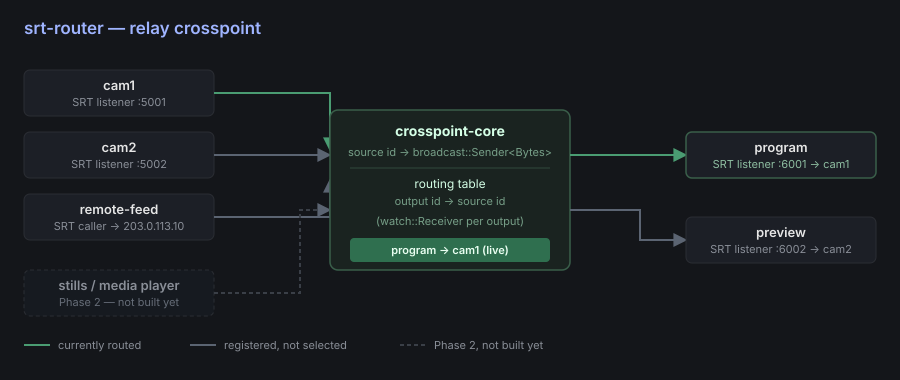
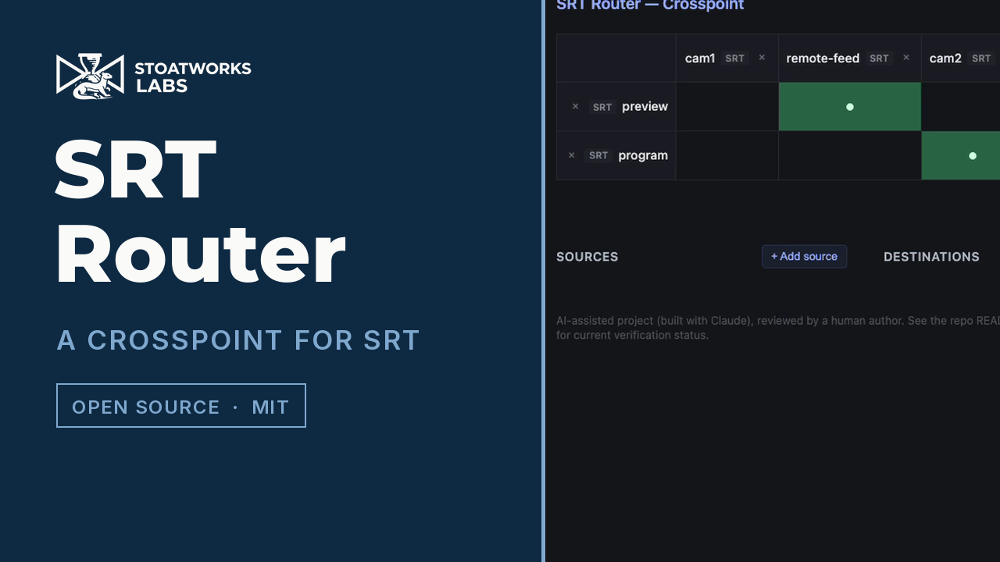
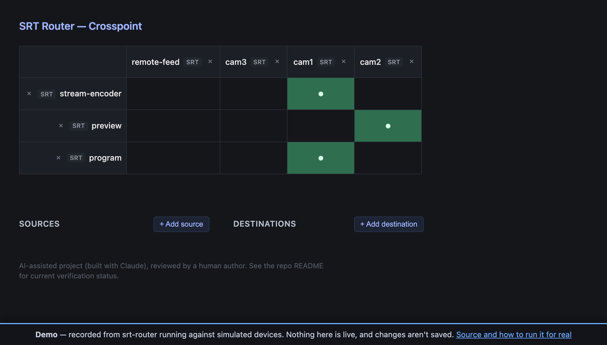
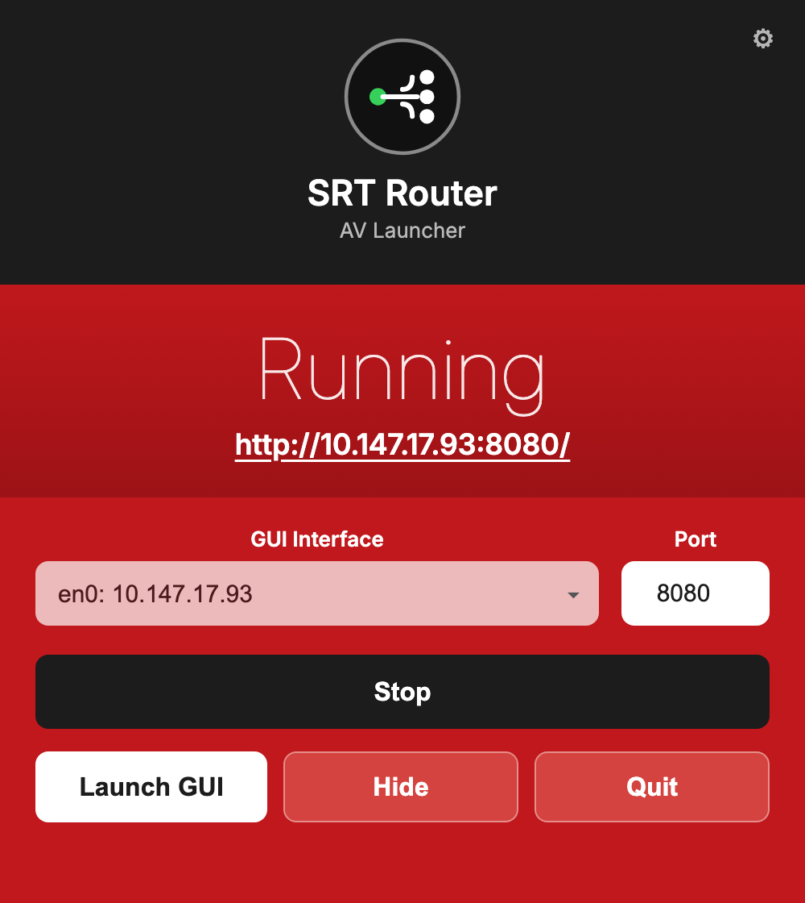

# srt-router

> **AI-assisted project.** This codebase was created with [Claude](https://claude.com/claude-code)
> (Anthropic), directed and reviewed by a human author. I've run the relay/crosspoint
> engine and the web UI locally, including integration tests that relay real SRT and NDI
> protocol traffic end to end and a live crosspoint switch from the web UI (see
> [Status](#status)), but it **hasn't yet been run against real-world third-party SRT/NDI
> encoders or decoders, or over an actual (non-loopback) network path**. Check it over before
> you rely on it for anything live.

A crosspoint router for [SRT](https://www.srtalliance.org/): any number of SRT inputs, any
number of SRT outputs, and a router-style crosspoint between them where each output takes
exactly one source and you can switch it live. It's the same idea as a broadcast video
router, with SRT streams instead of SDI or HDMI, and a lot less to carry up the stairs.



[](https://www.youtube.com/watch?v=Jp6JLf51UgY)

*A 45-second tour, driven over the router's own REST API against
[config/example.toml](config/example.toml), the same config as the screenshot below.*



*That's a real screenshot of the router running locally against
[config/example.toml](config/example.toml), not a mockup, taken while I was checking the
routing, persistence, websocket and add/remove behaviour described under
[Status](#status).*

You can try the crosspoint at <https://srt-router-demo.stoatworks-labs.com>. It's the
router's own UI in your browser, and the grid does switch: every click replays the router's
recorded response to that particular crosspoint change. Nothing there is relaying a stream
and nothing gets saved, because the router has to be on the network with your SRT endpoints
to do anything real. [demo/README.md](demo/README.md) has how it's built.

<!-- downloads:start -->

## Download

**[v0.2.5](https://github.com/stoatworks-labs/srt-router/releases/tag/v0.2.5)** — prebuilt for macOS, Windows and Linux. Pick your platform:

<details>
<summary><b>macOS</b> — Universal (Apple Silicon + Intel)</summary>

| Build | Download | Size |
| --- | --- | --- |
| .dmg disk image (app) | [`srt-router-0.2.5-macos-app.dmg`](https://github.com/stoatworks-labs/srt-router/releases/download/v0.2.5/srt-router-0.2.5-macos-app.dmg) | 13 MB |
| .pkg installer (app) | [`srt-router-0.2.5-macos-app.pkg`](https://github.com/stoatworks-labs/srt-router/releases/download/v0.2.5/srt-router-0.2.5-macos-app.pkg) | 13 MB |
| Universal (Apple Silicon + Intel) · .tar.gz archive | [`srt-router-macos-universal.tar.gz`](https://github.com/stoatworks-labs/srt-router/releases/latest/download/srt-router-macos-universal.tar.gz) | 5.1 MB |

</details>

<details>
<summary><b>Windows</b> — x64, ARM64</summary>

| Build | Download | Size |
| --- | --- | --- |
| x64 · .exe installer | [`SRT.Router_0.2.5_x64-setup.exe`](https://github.com/stoatworks-labs/srt-router/releases/download/v0.2.5/SRT.Router_0.2.5_x64-setup.exe) | 3.7 MB |
| x64 · .msi installer | [`SRT.Router_0.2.5_x64_en-US.msi`](https://github.com/stoatworks-labs/srt-router/releases/download/v0.2.5/SRT.Router_0.2.5_x64_en-US.msi) | 6.3 MB |
| x64 · .zip archive | [`srt-router-windows-x86_64.zip`](https://github.com/stoatworks-labs/srt-router/releases/latest/download/srt-router-windows-x86_64.zip) | 2.2 MB |
| ARM64 · .zip archive | [`srt-router-windows-aarch64.zip`](https://github.com/stoatworks-labs/srt-router/releases/latest/download/srt-router-windows-aarch64.zip) | 2.1 MB |

</details>

<details>
<summary><b>Linux</b> — x64, ARM64</summary>

| Build | Download | Size |
| --- | --- | --- |
| x64 · .deb package (Debian/Ubuntu) | [`srt-router_0.2.5_amd64.deb`](https://github.com/stoatworks-labs/srt-router/releases/download/v0.2.5/srt-router_0.2.5_amd64.deb) | 2.8 MB |
| ARM64 · .deb package (Debian/Ubuntu) | [`srt-router_0.2.5_arm64.deb`](https://github.com/stoatworks-labs/srt-router/releases/download/v0.2.5/srt-router_0.2.5_arm64.deb) | 2.9 MB |
| x64 · .rpm package (Fedora/RHEL) | [`srt-router-0.2.5-1.x86_64.rpm`](https://github.com/stoatworks-labs/srt-router/releases/download/v0.2.5/srt-router-0.2.5-1.x86_64.rpm) | 2.9 MB |
| ARM64 · .rpm package (Fedora/RHEL) | [`srt-router-0.2.5-1.aarch64.rpm`](https://github.com/stoatworks-labs/srt-router/releases/download/v0.2.5/srt-router-0.2.5-1.aarch64.rpm) | 3.0 MB |
| x64 · AppImage | [`SRT.Router_0.2.5_amd64.AppImage`](https://github.com/stoatworks-labs/srt-router/releases/download/v0.2.5/SRT.Router_0.2.5_amd64.AppImage) | 86 MB |
| x64 · .tar.gz archive | [`srt-router-linux-x86_64.tar.gz`](https://github.com/stoatworks-labs/srt-router/releases/latest/download/srt-router-linux-x86_64.tar.gz) | 2.8 MB |
| ARM64 · .tar.gz archive | [`srt-router-linux-aarch64.tar.gz`](https://github.com/stoatworks-labs/srt-router/releases/latest/download/srt-router-linux-aarch64.tar.gz) | 2.8 MB |

</details>

All builds, checksums and release notes: [github.com/stoatworks-labs/srt-router/releases](https://github.com/stoatworks-labs/srt-router/releases).

macOS builds are signed and notarised and open normally. The Windows builds are unsigned, so SmartScreen warns once — see [Windows SmartScreen & Defender Firewall](#windows-smartscreen--defender-firewall) for the one-time click-through.

<!-- downloads:end -->

## What it does

By default, routing is a **pure relay**. The crosspoint moves opaque payload chunks from an
input SRT connection to an output SRT connection without decoding or re-encoding anything, so
switching is effectively free: no transcode cost, and no latency beyond SRT's own buffering.
That's right for the common case, which is plain stream switching, but a source can be other
things too. The engine's idea of a source only cares about the payload (see
[docs/architecture.md](docs/architecture.md)), so sources that make a stream of their own,
such as a still image, a local media player or a scaler tap on another source, plug into the
same crosspoint as a "source" without the engine minding that they aren't relayed SRT.
They're **built**: `crates/media-io` runs `ffmpeg` as a child process for all three
(stills/media-player/scaler) and publishes plain MPEG-TS `Bytes`, the same wire format an SRT
relay carries, so a stills slate can feed a live SRT output directly with no transcoding step.
There's no SDK and no Cargo feature, just `ffmpeg` on `PATH` at runtime. See
[Status](#status).

You control it from a local web UI backed by a small REST API: a crosspoint grid (click a
cell to route that output from that source), plus **Add source**/**Add destination** menus
and a remove control on every row and column, so you can add or tear down SRT inputs and
outputs at runtime as well as using what was in the TOML config at startup. There's no auth
or TLS. It's meant to run on a trusted operations network, with the same trust model as a
hardware router's control port.

**Transports beyond SRT:** `crates/ndi-io` is an actual, tested NDI transport, and
`crates/omt-io` is the same idea for [OMT](https://openmediatransport.org/), an open,
MIT-licensed alternative to NDI, done with hand-written FFI against the real SDK (it needs
`OMT_LIB_DIR`, and there's no bindgen). Both are fully wired into the router: you can use them
from the TOML config, the runtime add-source/add-destination REST API **and** the web UI's
Add source/Add destination menus. **NDI is on by default**: it loads its runtime at run time
and needs no SDK to build. OMT stays behind an opt-in `omt` Cargo feature because it still
links at build time (`cargo run --features omt`). `crates/media-io`
(stills/media-player/scaler, see [What it does](#what-it-does)) doesn't need a feature, just
`ffmpeg` on `PATH`. Every input and output entry, TOML or REST, now needs an explicit
`transport = "srt" | "ndi" | "omt" | "media"` tag; see
[config/example.toml](config/example.toml).

## Status

**Phase 1: relay-only crosspoint + web UI, dynamic add/remove. Done.**
**Phase 2: special-purpose (non-relay) sources. Done.**
**Phase 3 (current): operational hardening.** Persisted routing and websocket push are done;
auth/TLS, SRT connection health and multiview are still to do.
Working:

- SRT input/output as either `listener` (this router waits for a
  connection) or `caller` (this router dials out), each reconnecting on its
  own if the connection drops.
- The crosspoint engine (`crates/core`), with the output-follows-route-change
  behaviour unit tested.
- A local web UI (`crates/web`): a grid of outputs x sources, click to route,
  updated live over a websocket (`GET /ws`) with a REST poll
  (`GET /api/state`) for the first paint and as a fallback.
- **Runtime add/remove**: `POST`/`DELETE /api/manage/sources` and
  `/api/manage/outputs` (`crates/router/src/management.rs`) spawn or tear
  down an SRT input/output on the fly, using the same code path the static TOML
  config uses at startup, so a source declared in the config is just as
  removable as one added later. Each task has a
  [`tokio_util::sync::CancellationToken`](https://docs.rs/tokio-util) (added
  to `srt-io`), so removing one actually stops the task and frees the socket
  rather than just forgetting about it. The web UI exposes this as **Add
  source**/**Add destination** forms plus a remove control per row/column.
- Routing changes optionally persist to disk (`[state]` in the config) and
  reload on restart, overriding each output's `default_source`.
- `crates/ndi-io`: an NDI transport, with its own integration test driving
  a real NDI sender and receiver against it, which passes consistently. Fully wired
  into `srtrouter`'s TOML config, the runtime add/remove REST API, **and** the
  web UI's Add source/Add destination menus. **Built by default**: its `sys`
  module loads the NDI runtime with `dlopen`, so nothing needs the proprietary
  SDK at build time and NDI is present in every cross-compiled release. (It
  used to use `grafton-ndi`, which linked the SDK at build time, and that kept
  the feature off for every release target, so released binaries had no NDI at
  all.) A machine with no NDI runtime still builds and runs the router; only an
  NDI endpoint fails, and the message names the download.
- `crates/omt-io`: a tested [OMT](https://openmediatransport.org/)
  transport via hand-written FFI against the OMT SDK (`OMT_LIB_DIR`, no
  bindgen), with its own relay integration test. Wired in the same way as
  NDI (TOML config, REST API, web UI menus), behind an opt-in `omt` Cargo
  feature (`cargo run --features omt`). It works alongside NDI, which is on by
  default, and an explicit `transport` tag on every input and output tells
  them apart even where their endpoint shapes are otherwise identical (NDI's
  and OMT's `Sender { name }` in particular; [docs/roadmap.md](docs/roadmap.md)
  says why that mattered).
- `crates/media-io`: stills, a local media player, and a decode/rescale/
  re-encode scaler tap, each running real `ffmpeg` as a child process and
  publishing plain MPEG-TS `Bytes`, with no envelope, no proprietary SDK and
  no Cargo feature (just `ffmpeg` on `PATH`). Fully wired into the TOML
  config, the REST API and the web UI's Add source menu (as sources only,
  since none of these makes sense as an output). A `media` source routes
  straight into an SRT output with no transcoding step, because they share
  the same raw-MPEG-TS payload class, and the web crate's cross-kind route
  check says so explicitly rather than requiring the kind strings to match.
  Scaler also consumes another registered source's own `Bytes` (subscribe,
  pipe into ffmpeg's stdin), which makes it the one non-relay path here that
  does transcode.
- Companion control:
  [companion-module-srt-router](https://github.com/stoatworks-labs/companion-module-srt-router),
  released separately, does takes, cycles, salvos and runtime add/remove over
  the REST API and websocket, with crosspoint and source-side tally. Its own
  tests run against a stand-in router.
- CI (GitHub Actions) runs `fmt --check`, `clippy -D warnings` and the
  test suite on every push and PR, for SRT, media and NDI. `ndi-io` builds
  there because it needs no SDK, and its tests that need a runtime skip
  themselves, so CI covers its envelope and struct-layout tests. `omt-io`
  needs an SDK CI can't install, so it's a workspace member left out of
  `default-members`; `media-io` only needs `ffmpeg`, which CI installs (see
  [docs/architecture.md](docs/architecture.md)).
- Verified locally, not just compiled: `cargo test` passes, and the default
  build (SRT + media + NDI) and `--features omt` both build and pass clean,
  including integration tests
  (`crates/srt-io/tests/relay.rs`, `crates/ndi-io/tests/relay.rs`,
  `crates/omt-io/tests/relay.rs`, `crates/media-io/tests/relay.rs`) that
  relay real protocol traffic (or, for media-io, real ffmpeg-produced
  MPEG-TS, byte-checked for valid sync bytes) end to end through the
  crosspoint. One SRT test also does a **live re-route mid-stream over an
  already-established connection**, and one media-io test proves the scaler
  recovers once its upstream source turns up late. I also checked by hand
  that running the binary against `config/example.toml` binds real UDP/SRT
  listener sockets (seen with `lsof`), adding a source through the web UI
  binds a new one live and removing it frees the port (also `lsof`), the REST
  API and a real browser click both drive live crosspoint changes, the
  websocket push updates the grid with no client-side polling, a persisted
  route survives a real process restart, adding an OMT source/destination
  through the running web UI produces the right `omt`-badged rows on the
  grid, and adding real stills/media-player/scaler sources through the
  running web UI (backed by real generated test images and video) produces
  `media`-badged rows that route cleanly into a live SRT output.

**Not done yet:** no test against a real third-party SRT/NDI/OMT encoder or
decoder, or over a real (non-loopback) network path. It's only been tested
locally so far, and that's still the main gap. Also missing: auth on the web
UI/API. [docs/roadmap.md](docs/roadmap.md) has the full phased plan.

## Quick start

```sh
cargo run --bin srtrouter -- --config config/example.toml
```

Then open `http://localhost:8080` for the crosspoint grid. Edit
[config/example.toml](config/example.toml) (or point `--config` at your own
file) to declare your actual inputs and outputs; the comments in that file
explain the format.

## Desktop app

Rather not touch the terminal? A small menu-bar app lets you pick the network
interface and port, start and stop the server, and open the web UI. The `srtrouter`
server is bundled inside, so it's a single download with nothing to install or wire
up. Grab the `.dmg` from
[Releases](https://github.com/stoatworks-labs/srt-router/releases), or see
[launcher/](launcher/) to build it yourself.

<p align="center"></p>

## Architecture

See [docs/architecture.md](docs/architecture.md) for the source/output/
crosspoint model and how the relay-vs-generated source distinction is meant
to extend later without changing the core engine.

## Windows SmartScreen & Defender Firewall

macOS builds are **Developer ID-signed and notarised by Apple**, so they open
normally, with no Gatekeeper warning and no quarantine step. The Windows
binaries **aren't** code-signed, so Windows still warns you the first time.

- **Windows**: SmartScreen shows *"Windows protected your PC"* →
  **More info** → **Run anyway**.
- **Windows Defender Firewall**: the first launch pops up *"Allow SRT Router to communicate on
  these networks"*. Tick **Private** (and **Domain** on a managed network), because SRT Router
  needs it to serve the web UI on the interface you pick and accept inbound SRT streams.
  Deny it and the UI won't load from another machine and inbound SRT callers will time
  out.
- **Linux**: no signing gate.

Per-artifact steps, self-signing, checksum verification and the Defender Firewall reset
procedure: **[docs/UNSIGNED.md](docs/UNSIGNED.md)**.

## Roadmap / TODO

Full phased plan in [docs/roadmap.md](docs/roadmap.md). Main open items:

- [ ] **Real-world testing**: against a third-party SRT/NDI/OMT encoder/decoder and over a real (non-loopback) network path. This is the main open gap.
- [x] **NDI and OMT live in the web UI, config, and REST API**, told apart by an explicit `transport` tag per input/output. NDI ships by default (runtime loaded with `dlopen`, no SDK needed to build); OMT stays behind an opt-in `omt` feature.
- [x] **Special-purpose sources**: stills, local media player and scaler tap, all built on real `ffmpeg` child processes and live in the web UI's Add source menu, config, and REST API.
- [ ] **Auth/TLS** on the web UI/API.
- [x] **Bitfocus Companion**: [companion-module-srt-router](https://github.com/stoatworks-labs/companion-module-srt-router) drives the crosspoint over the REST API. See [Control it from Companion](#control-it-from-companion).

## Control it from Companion

[**companion-module-srt-router**](https://github.com/stoatworks-labs/companion-module-srt-router) is a [Bitfocus Companion](https://bitfocus.io/companion) connection module for this app.

It does takes, cycles and salvos on the crosspoint, plus runtime add/remove,
with crosspoint tally and source-side tally.

Crosspoint presets are **generated from the router's own sources and outputs**
once the module connects, one section per output, so a row of buttons is one
section dragged onto a page.

It's not in the official Companion module store, so install it via
**Settings → Developer modules path**.

## Trademarks and third-party licences

**NDI® is a registered trademark of Vizrt NDI AB.** See <https://ndi.video>.
This project is not affiliated with or endorsed by Vizrt.

The NDI runtime is obtained separately under Vizrt's own terms and is not
redistributed here. NDI Tools are not redistributed either — get them from
<https://ndi.video/tools>.

H.264, H.265 and AAC are separately licensable formats. The NDI SDK grant does
not cover them, and the obligation sits with whoever ships a product using them.

<!-- attributions:start -->
This project is built on other people's work — see [ATTRIBUTIONS.md](ATTRIBUTIONS.md).
<!-- attributions:end -->
